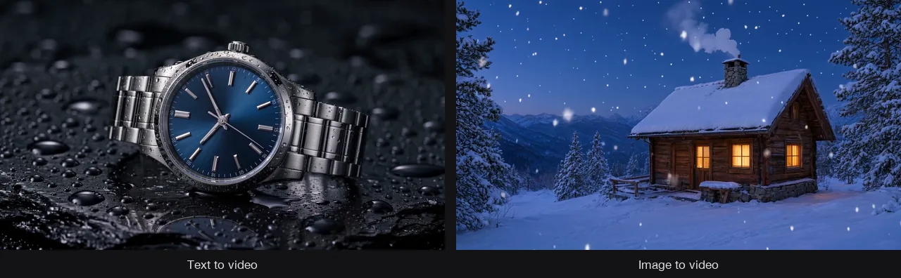
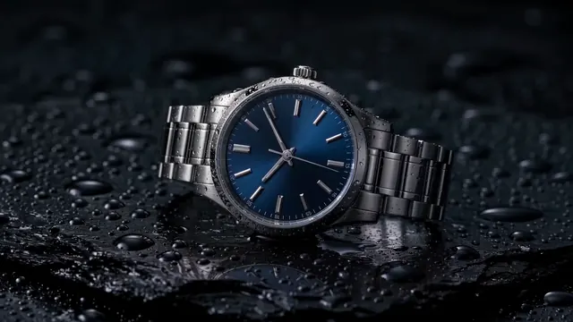
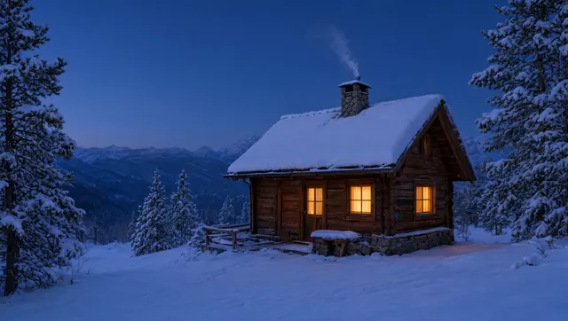

# AI Video Generator Skill

[English](./README.md) | [简体中文](./README.zh-CN.md) | 日本語

> 👉 こちらもどうぞ [AI Image Generator Skill](https://github.com/beatra-ai/ai-image-generator-skill)

テキスト、画像、最初と最後のフレーム、参考素材、既存クリップから、広告・商品紹介・SNS・Bロール・シネマティックな短い動画の生成、アニメーション化、編集、延長まで。Claude Code、Cursor、Codex、Windsurf、Cline、OpenClaw のどれからでもそのまま使えます。

> [!IMPORTANT]
> 生成には [Beatra](https://beatra.ai) アカウントが必要で、クレジットを消費します。スキル自体のインストールは無料です。

| 項目 | 内容 |
| --- | --- |
| **できること** | テキスト、画像、最初と最後のフレーム、参考素材、既存映像から、広告・商品・SNS向けの短いAI動画を生成、編集、延長します。 |
| **モデル** | Qwen Image 2.0 Fast、Qwen Image 3.0、Qwen Image 3.0 Pro、GPT Image 2.5 Flare、GPT Image 2.5 Sunburst、GPT Image 2、Wan Image 2.7 Fast、Qwen Image 2.0 Pro、Wan Image 2.7 Pro、MiniMax Image 01 Live、Seedance 2.0 Mini、Wan 2.7、Wan 3.0 Video、MiniMax H3、HappyHorse 1.1、Seedance 2.0 Fast、Seedance 2.0、Wan 3.0 Video Prime、Seedance 2.5、Wan 2.7 Video Edit、HappyHorse 1.0 Video Edit |
| **動作要件** | Python 3.10 以上と、`SKILL.md` を読み込めるエージェント |
| **費用** | インストールは無料。生成のたびに Beatra アカウントのクレジットを消費しますが、課金されるのは、その生成を明示的に依頼したとき、または確認カードを承認したときだけです。 |
| **対応エージェント** | Claude Code、Cursor、Codex、Windsurf、Cline、OpenClaw |

<p align="center"></p>

*各クリップから 1 フレームずつ：テキストから生成した架空の腕時計の商品ショット（左）と、画像から生成した雪の山小屋のシーン（右）。Beatra AI で生成。*

| Skill | Entry point | Version |
| --- | --- | --- |
| [`beatra-ai-video-studio`](skills/beatra-ai-video-studio) | [SKILL.md](skills/beatra-ai-video-studio/SKILL.md) | 1.3.5 |

このリポジトリは [beatra-ai/beatra-skills](https://github.com/beatra-ai/beatra-skills/tree/main/skills/beatra-ai-video-studio) から自動的に公開されています。問題の報告はそちらへお願いします。

## インストール

[`skills`](https://skills.sh) CLI を使う場合：

```bash
npx skills add beatra-ai/ai-video-generator-skill
```

GitHub CLI を使う場合：

```bash
gh skill install beatra-ai/ai-video-generator-skill beatra-ai-video-studio
```

または、このリポジトリをクローンして `skills/beatra-ai-video-studio` を次の場所にコピーします：Claude Code は `~/.claude/skills/`、Cursor は `~/.cursor/skills/`、Codex は `~/.agents/skills/`、Windsurf は `~/.codeium/windsurf/skills/`、Cline は `~/.cline/skills/`、OpenClaw は `~/.openclaw/skills/`。

または、次の文をエージェントに貼り付けてください：

```text
https://github.com/beatra-ai/ai-video-generator-skill から beatra-ai-video-studio スキル（フォルダ skills/beatra-ai-video-studio）をインストールし、その SKILL.md に従って私の Beatra アカウントに接続してください。
```

## 作例

<p align="center"></p>

[▶ フル動画を見る（MP4）](assets/full-1.mp4)

*濡れた黒い石の上の架空の腕時計を柔らかいリムライトで捉えた、テキストから生成した 4 秒・1080p の動画の全編。環境音はモデルが生成。Beatra AI で生成。*

エージェントへの依頼例：

```text
テキストから 4 秒のシネマティックな商品クリップを作って：ミッドナイトブルーの文字盤で文字もロゴもないスチールの自動巻き腕時計が、濡れた黒い石の上に置かれ、カメラがゆっくり寄り、柔らかいリムライトが当たる。
```

プロンプト：

```text
Cinematic luxury product ad shot. A steel automatic wristwatch with a deep midnight-blue sunburst dial, plain polished baton hour markers, no text and no logos on the dial, lies on a slab of wet black stone covered in small water droplets. Dark studio, soft rim light traces the case edge and bracelet, a gentle highlight glides across the sapphire crystal. The camera makes one slow, steady push-in from a three-quarter view toward the dial; a single water droplet slides slowly down the stone beside the watch. The watch stays perfectly still and keeps its exact shape, the second hand ticks smoothly. Shallow depth of field, crisp macro detail, restrained elegant pacing, ends on a close framing of the dial. Subtle ambient sound of soft water drips.
```

<p align="center"></p>

[▶ フル動画を見る（MP4）](assets/full-2.mp4)

*降る雪と立ちのぼる煙突の煙のある雪の山小屋の、画像から生成した 5 秒・720p の動画の全編。環境音はモデルが生成。Beatra AI で生成。*

エージェントへの依頼例：

```text
./cabin-blue-hour.png を 5 秒のクリップにして：画面全体にやさしく雪が降り、煙突の煙が左へゆっくり巻き、窓明かりが温かく光り、カメラが一度だけゆっくり滑らかに寄る。
```

プロンプト：

```text
Gentle falling snow drifts down across the whole scene in soft, slow flakes. Chimney smoke rises and curls lazily to the left. The window light glows warmly with a faint flicker. The camera makes one slow, smooth push-in toward the cabin. The cabin, roof, pine trees and mountains stay still and keep their exact shape. Calm, quiet winter evening pacing. Soft ambient sound of wind and falling snow.
```

## 技術仕様と出力上限

2026-10-18 時点。最新の一覧：https://docs.beatra.ai/ja/docs/models

- **アップロード** — 1 ファイルあたり最大 100 MB。下記の各モデルの入力制限も適用されます
- **テキストから画像** — 10 モデル（Qwen Image 2.0 Fast、Qwen Image 3.0、Qwen Image 3.0 Pro、GPT Image 2.5 Flare、GPT Image 2.5 Sunburst、GPT Image 2、Wan Image 2.7 Fast、Qwen Image 2.0 Pro、Wan Image 2.7 Pro、MiniMax Image 01 Live）／PNG／1 リクエストあたり最大 4 枚／キャンバス最大 16.8 MP
  - 16.8 MP（4K ティア）：Wan Image 2.7 Pro（1 リクエストあたり最大 4 枚）／GPT Image 2.5 Flare、GPT Image 2.5 Sunburst、GPT Image 2（1 リクエストにつき 1 枚）
- **画像から画像** — 10 モデル（Qwen Image 2.0 Fast、Qwen Image 3.0、Qwen Image 3.0 Pro、Wan Image 2.7 Fast、Qwen Image 2.0 Pro、Wan Image 2.7 Pro、GPT Image 2.5 Flare、GPT Image 2.5 Sunburst、GPT Image 2、MiniMax Image 01 Live）／PNG／1 リクエストあたり最大 4 枚／キャンバス最大 16.8 MP
  - 16.8 MP（4K ティア）：GPT Image 2.5 Flare、GPT Image 2.5 Sunburst、GPT Image 2（1 リクエストにつき 1 枚）
  - 入力画像：1 リクエストあたり最大 4 枚、各 10〜20 MB／BMP、GIF、JPEG、PNG、TIFF、WEBP
- **画像編集** — 6 モデル（Qwen Image 2.0 Fast、Qwen Image 3.0、Qwen Image 3.0 Pro、Wan Image 2.7 Fast、Qwen Image 2.0 Pro、Wan Image 2.7 Pro）／PNG／1 リクエストあたり最大 4 枚／キャンバス最大 4.2 MP
  - 4.2 MP（2K ティア）：Qwen Image 2.0 Fast、Qwen Image 3.0、Qwen Image 3.0 Pro、Wan Image 2.7 Fast、Qwen Image 2.0 Pro、Wan Image 2.7 Pro（1 リクエストあたり最大 4 枚）
  - 入力画像：1 リクエストあたり最大 4 枚、各 10〜20 MB／BMP、GIF、JPEG、PNG、TIFF、WEBP
- **テキストから動画** — 9 モデル（Seedance 2.0 Mini、Wan 2.7、Wan 3.0 Video、MiniMax H3、HappyHorse 1.1、Seedance 2.0 Fast、Seedance 2.0、Wan 3.0 Video Prime、Seedance 2.5）／480p〜4K／2〜30 秒／アスペクト比 16:9、1:1、21:9、3:4、4:3、9:16、4:5、5:4、9:21／MOV、MP4
  - 4K：Seedance 2.0、最長 15 秒
  - 30 秒：Wan 3.0 Video、Wan 3.0 Video Prime、Seedance 2.5、最高 1080p
  - ネイティブ音声：Wan 2.7、MiniMax H3
- **画像から動画** — 9 モデル（Wan 2.7、Wan 3.0 Video、MiniMax H3、Seedance 2.0 Mini、HappyHorse 1.1、Seedance 2.0 Fast、Seedance 2.0、Wan 3.0 Video Prime、Seedance 2.5）／480p〜4K／2〜30 秒／アスペクト比 16:9、1:1、21:9、3:4、4:3、9:16／MOV、MP4
  - 4K：Seedance 2.0、最長 15 秒
  - 30 秒：Wan 3.0 Video、Wan 3.0 Video Prime、Seedance 2.5、最高 1080p
  - ネイティブ音声：Wan 2.7、MiniMax H3
- **最初と最後のフレームから動画** — 8 モデル（Wan 2.7、Wan 3.0 Video、MiniMax H3、Seedance 2.0 Mini、Seedance 2.0 Fast、Seedance 2.0、Wan 3.0 Video Prime、Seedance 2.5）／480p〜4K／2〜30 秒／アスペクト比 16:9、1:1、21:9、3:4、4:3、9:16／MOV、MP4
  - 4K：Seedance 2.0、最長 15 秒
  - 30 秒：Wan 3.0 Video、Wan 3.0 Video Prime、Seedance 2.5、最高 1080p
  - ネイティブ音声：Wan 2.7、MiniMax H3
- **参照素材から動画** — 9 モデル（Wan 2.7、MiniMax H3、Wan 3.0 Video、HappyHorse 1.1、Seedance 2.0 Mini、Seedance 2.0 Fast、Seedance 2.0、Wan 3.0 Video Prime、Seedance 2.5）／480p〜4K／2〜30 秒／アスペクト比 16:9、1:1、3:4、4:3、9:16、21:9、4:5、5:4、9:21／MOV、MP4
  - 4K：Seedance 2.0、最長 15 秒
  - 30 秒：Wan 3.0 Video、Wan 3.0 Video Prime、Seedance 2.5、最高 1080p
  - ネイティブ音声：Wan 2.7、MiniMax H3
- **動画編集** — 8 モデル（Wan 2.7 Video Edit、Wan 3.0 Video、HappyHorse 1.0 Video Edit、Seedance 2.0 Mini、Seedance 2.0 Fast、Seedance 2.0、Wan 3.0 Video Prime、Seedance 2.5）／480p〜4K／2〜30 秒／アスペクト比 16:9、1:1、3:4、4:3、9:16、21:9／MOV、MP4
  - 4K：Seedance 2.0、最長 15 秒
  - 30 秒：Wan 3.0 Video、Wan 3.0 Video Prime、Seedance 2.5、最高 1080p
- **動画の延長** — 7 モデル（Wan 2.7、Wan 3.0 Video、Seedance 2.0 Mini、Seedance 2.0 Fast、Seedance 2.0、Wan 3.0 Video Prime、Seedance 2.5）／480p〜4K／2〜30 秒／アスペクト比 16:9、1:1、21:9、3:4、4:3、9:16／MOV、MP4
  - 4K：Seedance 2.0、最長 15 秒
  - 30 秒：Wan 3.0 Video、Wan 3.0 Video Prime、Seedance 2.5、最高 1080p
  - ネイティブ音声：Wan 2.7

## 得られるもの

- **制作前に演出を整理** — 動き、カメラ、テンポ、長さ、用途を決めてから映像を作ります。
- **素材に合う始め方** — テキスト、最初の画像、最初と最後のフレーム、参考素材、既存映像から始められます。
- **必要な部分だけ改善** — 生成された動画の動きと安定性を確認し、編集、延長、再生成から次の一手を選びます。

## 活用シーン

- **商品動画** — 商品ストーリー、商品写真、参考素材から短いデモやリビールを作ります。
- **AI広告動画** — ひとつのメッセージと動き、掲載先に合わせた短い広告映像を作ります。
- **SNS動画** — 縦型やフィード向けに、テンポ、画角、冒頭を設計します。
- **トランジションとリビール** — 最初と最後の画像を指定し、その間の動きを演出します。
- **映像の編集** — 既存映像の見た目や一部分を変更し、残したい要素を確認します。
- **Bロールと続きの映像** — 新しい補助ショットを作るか、1本の映像の直前・直後に内容を追加します。

## よくある質問

### Beatra AI動画スタジオでは何を作れますか？

テキスト、画像、参考素材、既存映像から、商品、広告、SNS、Bロール、トランジション、リビール、映像コンセプト向けの短い動画を作れます。

### 自分の画像から始められますか？

はい。1枚の画像を開始フレームにするか、最初と最後の画像を指定して、その間の動きを作れます。

### 既存映像の編集や延長はできますか？

はい。1本の映像の必要な部分だけを変更するか、その直前・直後に新しい内容を追加し、結果を確認できます。

### どの動画モデルを使いますか？

入力素材と制作条件に合う、現在利用可能なモデルを選びます。指定したモデルが対応していれば、そのまま使います。

### 長いシーケンスも作れますか？

長いアイデアをショットごとに企画し、順番に確認できるクリップを制作します。納品したショットは、字幕、ナレーション、トランジション、タイムライン編集へ整理して使えます。

## 更新とセキュリティ

2026 年 10 月のリリース以降、このスキルに自動更新機能はありません。インストールしたファイルだけを実行し、
自動的に置き換えることはありません。更新はインストールに使ったツール（`npx skills update beatra-ai-video-studio` または
`gh skill update beatra-ai-video-studio`）で行ってください。詳細はスキル内の `references/updates-and-security.md` を参照してください。

## ライセンス

[MIT-0](LICENSE)：商用を含め、自由に使用・改変・再配布できます。クレジット表記は不要です。ClawHub 上のこれらのスキルと同じ条件です。

## リンク

- ウェブサイト — https://beatra.ai
- ドキュメント — https://docs.beatra.ai
- コンソール — https://console.beatra.ai
- AI エージェント向け — https://beatra.ai/llms.txt（インデックス）· https://beatra.ai/llms-full.txt（全スキルを 1 ファイルに）
